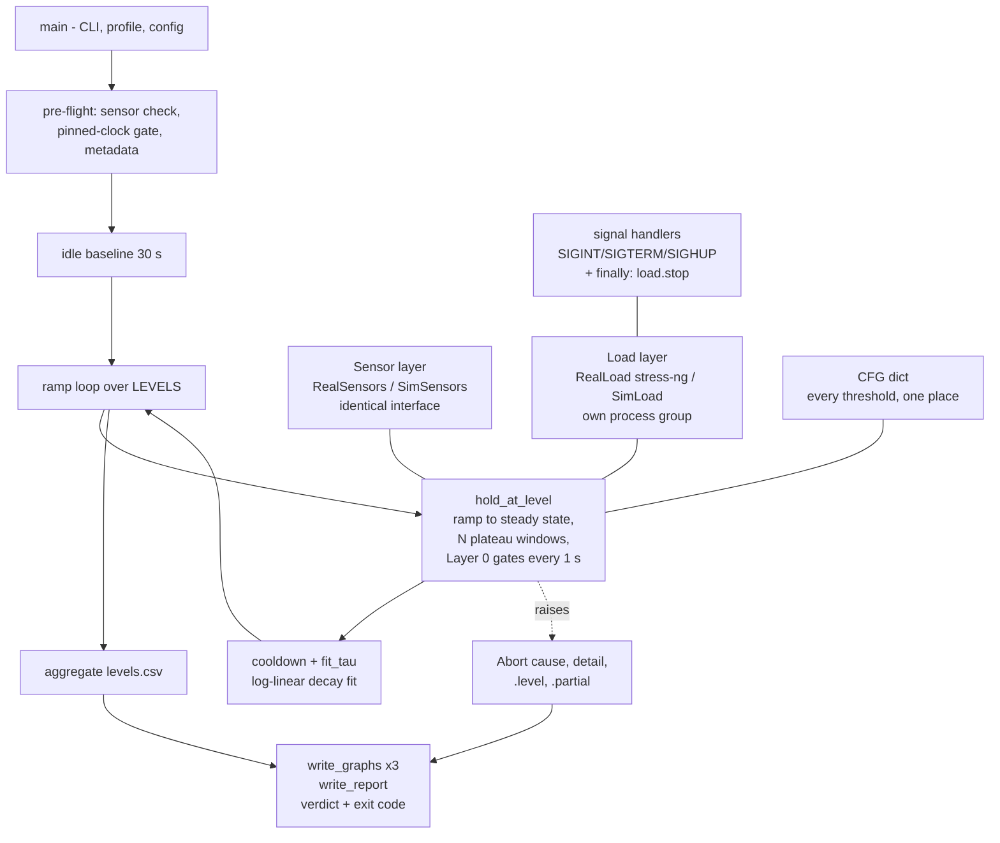
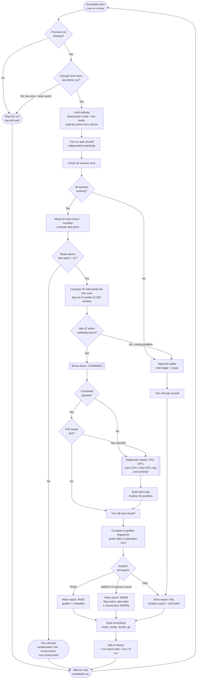
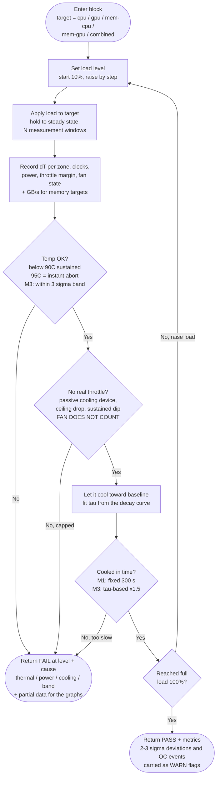

# PROJECT CONTEXT — Automated Stress Test for Jetson Orin Nano

**Purpose of this file:** complete handoff context. Read this first and you
have everything: the goal, every design decision and *why*, the hardware
facts, the code architecture, what is built, what is not, real measured
data from the board, open questions, and what to do next. Written so
development can continue with no re-derivation.

**Last updated:** after M1 first-hardware validation + severity-model revision.

---

## 1. Project identity

QA / testing-validation work on a **security robot project**. The robot's
compute board is an **NVIDIA Jetson Orin Nano Developer Kit**. The task:
replace ad-hoc manual feature testing with an **automated, scheduled stress
test** that proves the board endures its real operating load without
crossing a safety line, and that detects slow cooling degradation before it
causes a field failure.

Final product is fully specified in `docs/design/design_dossier.pdf`.
This file is the working context; the dossier is the formal spec.

---

## 2. Current status

| Milestone | Content | State |
|---|---|---|
| **M0** | Bench setup: tools verified, power/fan mode frozen, one manual stress observed | Script written (`src/m0_bench_check.py`); partially executed on hardware |
| **M1** | Measurement core: staged ramp, CPU target, safety gates, PASS/WARN/FAIL, graphs | **Built. First real run done. Severity model revised after that run. Re-run pending.** |
| M2 | All 5 targets (cpu/gpu/mem-cpu/mem-gpu/combined), independent hardware watchdog, I2C ambient sensor | Not started |
| M3 | Calibration campaign → golden fingerprint → statistical (2σ/3σ) verdicts | Not started |
| M4 | Automation: scheduler, overlap/wear guards, alerting, auto-commit (CI/CD-ready) | Not started |
| M5 | Trend intelligence: history DB, drift rules, health-over-time reporting | Not started |

**Immediate blocking item:** the revised M1 code has not yet been re-run on
the board. See §11.

---

## 3. Hardware facts (verified, with sources)

### 3.1 Architecture — the fact that shapes everything
Single Tegra SoC: 6-core Arm Cortex-A78AE CPU, 1024-core Ampere GPU (32
Tensor cores), 8 GB LPDDR5 on a 128-bit bus. **CPU, GPU and memory share
one die, one unified memory pool, one thermal solution, one power budget.**
Nothing can be tested in true isolation — heating one part heats all;
loading one part starves the others of power budget. This is why
"separate" tests exist for *attribution*, not isolation, and why the
combined test is the only realistic worst case.

### 3.2 Temperature lines (NVIDIA official)
| Line | Value | Meaning |
|---|---|---|
| Qualified operating range (Tj) | −25 … **90 °C** | Datasheet DS-11105. Below 90 °C = operating as designed |
| NVIDIA design target | ≤ **95 °C** | TDG-11127 §3 design examples keep 4 °C headroom for sensor error |
| Max operating temperature | **99 °C** | TDG Table 2-1. Above it, software thermal management cuts clocks |
| Hardware throttling | 99–105 °C | TDG §5.4. Locked by NVIDIA, cannot be altered |
| Shutdown | **105 °C** | TDG Table 2-1 / §5.5. Hardware halt |

**Our usage:** 90 °C = FAIL line · 95 °C = instant emergency stop ·
99/105 °C = the chip's own defences, which a correct test never reaches.

### 3.3 Clocks per power mode (published)
| Mode | CPU | GPU | EMC | Bandwidth |
|---|---|---|---|---|
| 15 W (legacy) | 1497 MHz | 611–625 MHz | 2133 MHz | 68 GB/s |
| 25 W "Super" | ~1728 MHz | 1007–1020 MHz | 3199 MHz | 102 GB/s |
| MAXN SUPER | uncapped | uncapped | uncapped | — |

**With `jetson_clocks` engaged, clocks are pinned at the mode maximum, so
expected clock is a CONSTANT at every load level.** Speed is not supposed
to rise with load — it is supposed to *not fall*. Any sustained dip is a
finding. (⚠️ see §10 — the actual board reports 1344 MHz, not 1728.)

### 3.4 Sensors and cooling
- **Six thermal zones** via sysfs: `cpu-thermal`, `gpu-thermal`,
  `soc0/1/2-thermal`, `tj-thermal`. `tj` = junction (hottest point), drives
  the fan controller.
- **13 cooling devices** on this board (`/sys/class/thermal/cooling_device*`).
  Linux registers *everything* that removes heat as a "cooling device",
  including **the fan** — this caused a false FAIL (see §7.1).
- **Fan**: `nvfancontrol`, two profiles (**quiet** default / **cool**), PWM
  0–255, RPM via hwmon. TMARGIN = 105 °C − avg(CPU, GPU, SoC zones).
- **Trip points** are readable per zone and are **read from the device at
  startup**, never hardcoded (firmware updates can move them).
- **No ambient sensor on the board** — room temp/humidity is typed by hand
  in M1 (`--ambient-c`, `--humidity`); I2C sensor arrives in M2.

### 3.5 Two distinct throttle causes
1. **Thermal throttling** — DVFS cuts clocks when a zone crosses a trip
   point. *Fan ramps first ("first line of defense"), capping second.*
2. **Over-current / power throttling** — "System throttled due to
   over-current": module power exceeded the budget. Appears in `dmesg`,
   independent of temperature, common on MAXN SUPER.

Different diagnoses (cooling problem vs power/supply problem) → logged as
separate flags.

### 3.6 Governor vs pinning (researched)
- Jetson's **default governor is `schedutil`** (NVIDIA Developer Guide),
  "primarily aimed at power saving" — it scales frequency **with** load by
  design. Observed variable clocks are *factory behaviour, not a fault*.
- schedutil's published law: `f = min(f_max, 1.25 × util × f_max)`,
  saturating at f_max from ~80 % load. (Kernel docs. Basis for a possible
  future governor-mode test — currently shelved.)
- **Pinning does NOT block protection.** `jetson_clocks` writes
  `scaling_min = scaling_max` (a *userspace request*). Thermal/electrical
  constraints are reconciled above it and always win; hardware throttle and
  the 105 °C shutdown live below the kernel entirely. This is exactly why
  the "ceiling drop" signal works — protection overriding the pin is
  visible as `scaling_max_freq` falling below its start-of-test value.

---

## 4. Design decisions (all settled — do not re-litigate without cause)

1. **Power mode + fan mode are FIXED and LOGGED.** Never MAXN SUPER for
   scheduled testing (NVIDIA labels it experimental, advises against
   prolonged heavy loads, OC-prone). Use the robot's deployment mode.
2. **Clocks PINNED, governor mode rejected.** Rationale: comparability is
   the core asset of a scheduled QA test — golden fingerprint, trend rules
   and week-over-week drift all assume fixed configuration. One mode = one
   calibration campaign. Full record:
   `docs/design/decision_record_clock_policy.md`. Governor mode + a
   throughput-decline witness (phone-benchmark style) are **documented and
   shelved**, re-openable later.
3. **Staged ramp, not a single all-out load** — stops at the first sign of
   trouble and reports *at which level*.
4. **Steady state, not snapshots** — hold each level until temperature
   plateaus before recording (temperature lags load).
5. **Statistics per level** — mean ± σ, never a single reading.
6. **All limits are ΔT-relative** (chip − room), with the absolute 90/95 °C
   caps layered on top. ΔT at a given level/mode is a property of *board
   health*, independent of the room.
7. **Cooling validation = "Basic" level:** (a) idle-vs-ambient pre-check
   before stressing; (b) cooldown timeout after load. "Recovered" =
   within ε (2 °C) of idle, never "equals baseline" (recovery is
   asymptotic).
8. **τ (cooling time constant) is the cooling-health metric.** Fitted
   log-linearly from the decay curve. τ is a property of the cooling
   *hardware*, ~independent of ambient and of load level → measure once per
   run (fast profile), not per level. Rising τ across runs = earliest
   fan/heatsink degradation signal.
9. **Humidity is a gate and an annotation, not a correction.** Effect on
   cooling capacity is ~1–2 % (below noise). Real risks: condensation
   (dew-point gate: refuse run if board ≤ dew point + 2 °C → *environment*
   fault, not board fault) and corrosion (RH > 85 % annotation).
10. **Four advanced ideas all adopted:** trend tracking across runs ·
    known-good fingerprint · throttle-margin logging (degrees of headroom,
    not just yes/no) · separate CPU/GPU/memory testing.
11. **Structure: one master flow + ONE reusable stress block** called with a
    `target` parameter (`cpu` / `gpu` / `mem-cpu` / `mem-gpu` / `combined`).
    Same ramp, gates and cooldown each time; only the load generator
    changes.
12. **Memory tested via BOTH drivers, reported separately** — memory is only
    reachable *through* CPU or GPU, so STREAM-style (CPU-driven) and CUDA
    (GPU-driven) are distinct results. Metric is **GB/s vs mode ceiling**,
    not MHz.
13. **Combined-first ordering.** Combined = harshest case + the robot's real
    operating condition. On a healthy board it passes and the separate
    sweep is skipped → most cycles are short. On failure → full diagnostic
    sweep with **log-and-continue** (the *pattern* of failures is the
    diagnosis).
14. **Accepted blind spot + mitigation:** combined is not a superset —
    shared power budget means no subsystem hits its individual peak clock
    during combined load, so a peak-per-unit defect could pass. Mitigated
    by a **periodic full sweep** (daily/weekly) regardless of pass/fail.
15. **Combined owns its own calibrated bands** — solo bands are never
    applied to combined runs.
16. **Two time profiles** (added after the full protocol proved too slow —
    ~2 h):
    - **`fast`** (default, ~10–12 min): 5 levels (10/25/50/75/100), ascending
      ramp with **no cooldowns between levels** (steady state is a physics
      equilibrium → path-independent), **3 measurement windows on one
      plateau** instead of 3 restarts, **one final decay** for τ.
    - **`deep`** (~1.5–2.5 h): 10 levels, 3 independent restart trials, full
      cooldown + τ per trial. For the M3 calibration campaign and an
      occasional weekly check.
    Honest trade-off: fast-profile σ measures *plateau stability*, not
    day-to-day repeatability — repeatability comes from scheduled
    repetition (trend history), and deep exists for when the full
    statistical treatment matters.
17. **Wear model:** damage risk ≈ zero (chip self-protects; software cannot
    exceed its ceiling). Real cost is **thermal cycling** (solder/interface
    fatigue), not time-at-temperature. Levers: minimum-interval guard in
    the scheduler, test frequency, cooldown depth. The fan is the part that
    genuinely wears — τ tracking detects it.
18. **Traceability:** every run writes metadata (board, firmware, power+fan
    mode, ambient, trip points read from device), raw CSV, per-level
    summary, graphs, verdict; everything version-controlled.
19. **CI/CD-ready by design** (this is what M4 becomes): exit codes
    **0=PASS / 1=WARN / 2=FAIL**, non-interactive CLI, self-contained
    artifact folder per run. Deployment pattern = **self-hosted runner on
    the rig** (hardware-in-the-loop), tagged job, `retry: 0` (never
    auto-retry a thermal FAIL — violates the wear guard), runner
    concurrency 1 (replaces the overlap lock).

---

## 5. Acceptance model (CURRENT — revised after first hardware run)

### Layer 0 — absolute, from NVIDIA, never recalibrated

**ABORT (FAIL) — real failures, i.e. performance or safety actually
compromised:**
| Condition | Cause label |
|---|---|
| Any zone ≥ 95 °C | `temperature-critical` (instant, no debounce) |
| Any zone ≥ 90 °C sustained > 5 s | `temperature` |
| **Passive/frequency-capping** cooling device active > 2 s | `throttle-thermal` |
| `scaling_max_freq` drops below its start-of-test value | `throttle-thermal` (ceiling drop) |
| Sustained clock < 98 % of pinned max for > 4 s | `throttle-dip` |
| Cooldown fails to reach idle + 2 °C within timeout | `cooling` |
| Operator stop (Ctrl-C / SIGTERM / SIGHUP) | `operator` |

**WARN + CONTINUE (verdict becomes WARN if run otherwise passes):**
- Over-current event in `dmesg` **without** clock consequence — the event
  is context; the ceiling/dip signals are ground truth for whether
  performance was actually reduced.
- An **unclassified** cooling-device type activating (conservative middle
  until its name is classified).

**NORMAL — logged as health data, never a failure:**
- **The FAN.** Fan spin-up is the first line of defense working. State and
  RPM recorded per level and plotted. Rising fan effort for the same load
  across weeks = early cooling-degradation signal.

**Pre-flight refusals (not board faults):**
- Sensors unreadable → test abandoned ("couldn't be done").
- **Clocks not pinned** → refuse to start, print the fix
  (`sudo nvpmodel -q` then `sudo jetson_clocks`) and the governor found.
- (M2+) board ≤ dew point + 2 °C → *environment* fault.

### Layer 1 — statistical, arrives in M3
Per (power mode, fan mode, target, level): μ and σ from ≥5 golden runs
spread across days; σ floored at 0.5 °C (sensor noise). Then: within 2σ =
PASS · 2σ–3σ = WARN · beyond 3σ = FAIL. Plus a clock floor of ≥98 % of
pinned max, and trend rules (7 consecutive runs on one side of μ → WARN;
τ rising monotonically over 5 runs → WARN; throttle margin shrinking over
5 runs → WARN).

**Bootstrap logic (important):** during calibration, "green" can only mean
Layer 0 clean + sanity anchor (idle ΔT ≈ 25–30 °C over room) + physical
inspection — Layer 1 cannot validate the runs that create it. Risk: a
sick baseline encodes illness as normal; mitigated by Layer 0, the sanity
anchor, and the fact that trend rules still catch *further* degradation.
Never do all golden runs in one afternoon (artificially tiny σ → false
FAILs later).

---

## 6. Code architecture

### 6.1 Two files, one derived from the other
- **`src/m1_stress_test.py`** — laptop build. Contains the physics
  simulator. Flags: `--dry-run`, `--quick`, `--sim-hot`, `--sim-throttle`,
  `--sim-warn`. This is the file that gets **edited**.
- **`src/m1_stress_test_jetson.py`** — Jetson deployment build.
  **DERIVED from the master by a scripted transform**, never hand-edited:
  cut `SimSensors` and `SimLoad` classes, remove all `--dry-run/--quick/
  --sim-*` flags and their branches, make `--ambient-c` unconditionally
  required, force real sensors/load, rewrite the header docstring.
  `--quick` is deliberately removed: shortened holds on real silicon would
  record pre-settling temperatures.
  **Rule: change the master, then re-derive. Never diverge them.**

### 6.2 Layers inside the script
1. **`CFG` dict** — every threshold in one place, each traceable to the
   acceptance criteria doc. No magic numbers in logic.
2. **Sensor layer** — `RealSensors` (sysfs) / `SimSensors` (first-order
   thermal model). Identical interfaces: `temps()`, `junction()`,
   `freqs_khz()`, `pinned_max_khz()`, `pinned_check()`, `governor()`,
   `ceiling_khz()`, `cooling_snapshot()`, `fan_reading()`, `trip_points()`,
   `cooling_map`.
3. **Load layer** — `RealLoad` (stress-ng) / `SimLoad`. Both expose
   `start(level_pct)` / `stop()`.
4. **Run logic** — `hold_at_level()`, `cooldown()`, `fit_tau()`,
   `sample_once()`, `Abort` exception, signal handlers.
5. **Reporting** — `write_graphs()`, `write_report()`.

### 6.3 Key implementation details
- **sysfs, not `tegrastats`** — tegrastats' text format shifts between
  JetPack versions; sysfs is a stable kernel ABI. Zones are **discovered at
  runtime** (glob + read each `type`), nothing hardcoded.
- **`time.monotonic()`** everywhere for durations (NTP adjustments can't
  corrupt "sustained for 5 s").
- **Cooling-device classification** at startup into `fan` / `throttle` /
  `other`:
  - `"fan" in type.lower()` → **fan** (active cooling, normal)
  - type contains any of `cpu, gpu, freq, emc, dram, balanced, throttle,
    cap` → **throttle** (passive capping = real throttle)
  - else → **other** (WARN, never abort)
  The full classification is written into `metadata.json` every run.
  ⚠️ Keyword matching is an educated guess until validated against the real
  13-device inventory — see §11.
- **`stress-ng` runs in its own process group** (`start_new_session=True`),
  killed via `os.killpg` (SIGTERM → wait 5 s → SIGKILL). It spawns 6
  workers; killing only the parent would orphan them.
- **Load dies on EVERY exit path**: `finally: load.stop()` + handlers for
  SIGINT, SIGTERM, **and SIGHUP** (dropped SSH session). `log()` swallows
  `OSError` so cleanup and file writes complete even with a dead terminal.
  Honest limit: `kill -9` runs no cleanup — that is why M1 requires a
  supervised operator and why M2 adds the independent hardware watchdog.
- **Steady-state detection**: compare mean tj of the last `STEADY_WINDOW_S`
  against the window before it; steady when |Δ| < 0.4 °C. `MIN_HOLD_S`
  prevents declaring steady during the ramp; `MAX_HOLD_S` prevents waiting
  forever on an asymptote.
- **Plateau windows (fast profile)**: after steady is declared, keep
  holding for (N−1) more windows, then slice the tail into N windows.
  Safety gates stay active throughout the extension.
- **Partial-data salvage**: `Abort` carries `.level` and `.partial`; an
  aborted level still appears in `levels.csv` (`status: FAILED`), in the
  report table (`<-- ABORTED AT THIS LEVEL`), and as a red ✗ annotation on
  the graphs. (This was a real bug found on hardware — the failing level's
  data used to vanish.)
- **All file writes are explicit UTF-8** (`encoding="utf-8"`) — the report
  contains σ, °, Δ, τ and Windows defaults to cp1252, which crashed. The
  console `print` has an ASCII fallback.

### 6.4 Outputs per run (`runs/run_YYYYMMDD_HHMMSS/`)
| File | Content |
|---|---|
| `report.txt` | Verdict first line, metadata, per-level table (incl. fan column), warnings section |
| `samples.csv` | Every second: `t_s, level_pct, trial, phase, tj_c, freq_min_khz, freq_mean_khz, fan_rpm, fan_pwm, fan_state, throttle_state, T_<zone>…` |
| `levels.csv` | Per-level summary (**the seed of M3's fingerprint** — format frozen deliberately) |
| `metadata.json` | Meta + trip points read from device + cooling-device classification + full config |
| `temp_vs_load.png` | f(load) = steady-state temperature, with 90/95 °C lines |
| `freq_vs_load.png` | g(load) = sustained clock vs pinned max (flat = healthy) |
| `fan_vs_load.png` | fan speed vs load, background zones shaded/labelled per fan mode |

Exit codes: **0 = PASS, 1 = WARN, 2 = FAIL**.

### 6.5 Code architecture (module map)



### 6.6 Master workflow (GRAFCET — the full design, M2+ target state)

Purple double-bracket nodes are macro-steps that expand into §6.7.
M1 currently implements the single-target path; the sweep and dew-point
gate arrive in M2, the fingerprint in M3, the scheduler in M4.



### 6.7 The reusable stress block (called per target)

This is what M1 implements today (with `target = cpu`).



Rendered versions of these charts (PNG + editable `.mmd`/`.dot` sources)
live in `docs/charts/`.

---

## 7. What happened on first hardware contact (do not repeat these)

### 7.1 The false FAIL — fan misread as throttling
First real fast run aborted at 75 % with
`throttle-thermal: kernel cooling active at level 75%: pwm-fan(cooling_device2)=1`.
**The "throttling device" was the fan.** Root cause: the detector treated
all 13 cooling devices as throttle evidence, but Linux registers *active*
cooling (fan) and *passive* cooling (frequency capping) the same way.
Fixed by the classification in §6.3 + the severity model in §5.
*Lesson encoded:* fan spin-up is the first line of defense working — it is
data, never a fault.

### 7.2 Governor mistaken for throttling
Earlier, variable clock speed looked like throttling. It was `schedutil`
doing normal power management. Fixed by: a **startup gate** that verifies
`scaling_min == scaling_max` on every core and refuses to run otherwise
(printing the governor found and the exact fix), plus moving throttle
detection onto authoritative kernel signals instead of inferring from the
raw clock.

### 7.3 Windows encoding crash
`UnicodeEncodeError` writing `report.txt` (cp1252 vs σ). Fixed by explicit
UTF-8 on all writes. *Never rely on platform default text encoding.*

### 7.4 Test too slow
Original protocol ≈ 2 h; cooldowns were 60–70 % of it. Fixed by the
fast/deep profiles (decision 16).

---

## 8. Repository layout

```
src/      m1_stress_test.py (master, w/ simulator) · m1_stress_test_jetson.py (derived)
          m0_bench_check.py (read-only bench readiness checker)
docs/     USAGE.md
  design/ design_dossier.pdf · acceptance_criteria.md · decisions.md
          decision_record_clock_policy.md · project_overview_development_plan.pdf
          hardware_reference.pdf
  charts/ master_flow.png/.mmd · stress_block.png/.mmd · simple_flow.png
ops/      M0_guide.md · bench_commands.md · ssh_commands.txt
presentation/  supervisor_review.pptx (3-min design review)
runs/     git-ignored (test data ≠ code); .gitkeep preserves the folder
```
Plus `README.md`, `.gitignore`, `requirements.txt` (matplotlib only, and it
is optional — CSV is the truth, graphs are a view).

---

## 9. Operational rules (bench + remote)

- **Order matters:** `sudo nvpmodel -m <N>` **then** `sudo jetson_clocks`.
  Changing the power mode resets pinning.
- **Pinning does NOT survive a reboot** — re-run `jetson_clocks` every boot.
  (M4 will fold this into the scheduled pre-flight.)
- **Always run inside `tmux`** over SSH. A dropped session would otherwise
  leave the detached load running with the monitor dead. (SIGHUP handling
  is the second line of defense; tmux is the first.)
- Two WSL windows: one drives, one monitors / stops.
- **Stop methods, in order:** Ctrl-C in tmux → `pkill -INT -f
  m1_stress_test_jetson.py` → `tmux kill-session -t stress` → emergency
  `pkill -9 -f m1_stress_test_jetson.py; pkill -9 stress-ng` (bypasses
  cleanup — always verify afterwards with `pgrep -a stress-ng` and falling
  temperatures).
- **Never auto-retry immediately after a FAIL** (wear guard).
- First contact with new hardware behaviour is done **physically at the
  board**, not remotely.
- Full command references: `ops/ssh_commands.txt` (remote),
  `ops/bench_commands.md` (local).

---

## 10. Real measured data (first hardware run, 2026-07-15)

```
board_model    : NVIDIA Jetson Orin Nano Engineering Reference Developer Kit Super
l4t_release    : R36
power_mode     : NV Power Mode: 25W / 1
fan_mode       : quiet
cpu_governor   : schedutil     clocks_pinned: True
pinned_max_mhz : 1344          cooling_devices: 13
zones          : cpu-, gpu-, soc0-, soc1-, soc2-, tj-thermal
ambient        : 24.5 °C       humidity: 60 %
idle_tj        : 52.62 °C      idle ΔT: 28.12 °C   ← squarely in the expected 25–30 °C band
```

| level | tj °C | ±σ | hottest °C | min clock MHz | margin→90 °C |
|---|---|---|---|---|---|
| 10 % | 52.9 | 0.05 | 53.5 | 1344 | 36.5 |
| 25 % | 53.5 | 0.03 | 54.0 | 1344 | 36.0 |
| 50 % | 54.5 | 0.12 | 54.9 | 1344 | 35.1 |
| 75 % | — | — | — | — | *(aborted: fan false-positive)* |

**Reading:** the board looks very healthy — idle ΔT exactly as predicted,
clocks perfectly flat at the pinned value, σ tiny (0.03–0.12 °C), ~35 °C of
margin at half load, temperature curve nearly flat and far from any limit.
The only failure was a classification bug, now fixed.

---

## 11. Open questions / pending validation

1. **RE-RUN THE FAST TEST** with the revised code (fan reclassification,
   WARN verdict, salvaged graphs, fan graph). Expected: fan steps up at
   75–100 %, appears in `fan_vs_load.png`, verdict PASS. If clocks genuinely
   cap near 100 % in 25 W mode, that is a *true* finding and the report will
   now show exactly where, at what temperature, and at what fan effort.
2. **Cooling-device inventory not yet collected.** Needed to validate the
   keyword classification against real device names:
   ```bash
   for c in /sys/class/thermal/cooling_device*; do \
     echo "$(basename $c): $(cat $c/type) state=$(cat $c/cur_state)/$(cat $c/max_state)"; done
   ```
   (The revised code also writes this into `metadata.json` automatically.)
3. **⚠️ `pinned_max_mhz = 1344` is unexplained.** Published 25 W "Super"
   CPU clock is ~1728 MHz; 15 W legacy is 1497 MHz. The board reports 1344.
   Investigate before M3 calibration (a fingerprint built on a
   misconfigured mode would be worthless). Check: `nvpmodel -q` full output,
   `/etc/nvpmodel.conf` mode definitions, `jetson_clocks --show`, whether
   JetPack is new enough for Super mode, and whether mode 1 on this board
   is actually the 25 W entry.
4. **M0 not fully executed** — checker output (`bench_report.txt`,
   `tegrastats_sample.txt`) not yet collected.
5. **Cooldown timeout is a generous fixed 300 s** in M1 (deliberate — M1
   does not yet know what normal recovery looks like). M3 derives it from
   the fitted τ: `t_expect × 1.5` where `t_expect = τ_golden · ln(ΔT_peak/ε)`.
6. **Idle ΔT plausibility band (10–45 °C) is informational only in M1** —
   becomes a hard pre-check gate once calibrated.

---

## 12. Next steps (in order)

1. **Re-run the fast test on the Jetson** with the revised code; collect
   `runs/` + the cooling-device inventory + M0 reports.
2. **Validate the classification** against the real device names; tighten
   the keyword rules if needed.
3. **Resolve the 1344 MHz question** (§11.3).
4. **Then M2**: reusable block generalised to all 5 targets (GPU load via
   `gpu_burn`/CUDA kernel; memory via STREAM-style CPU-driven *and* CUDA
   GPU-driven, metric GB/s); independent hardware watchdog; I2C ambient
   sensor (DHT22/BME280) replacing manual `--ambient-c`; dew-point gate;
   combined-first orchestration with the diagnostic sweep.
5. **Then M3**: calibration campaign (≥5 golden runs, deep profile, spread
   across days inside a 15–35 °C ambient window) → golden fingerprint →
   Layer 1 statistical verdicts.
6. **Then M4** (automation / CI-CD) and **M5** (trend intelligence).

---

## 13. Working conventions

- **Edit the master (`m1_stress_test.py`), then re-derive the Jetson build.**
  Never hand-edit the derived file.
- **Every threshold must be traceable** to `docs/design/acceptance_criteria.md`
  and ultimately to NVIDIA documentation or measured calibration. No
  invented numbers.
- **Safety is never traded for speed.** 1-second sampling and all Layer 0
  gates stay active in every profile, including during plateau extensions.
- **Verify before delivering:** run the dry-run PASS path, plus the
  `--sim-throttle` / `--sim-hot` / `--sim-warn` fault paths, after any
  change to run logic.
- **The CSV is the truth; graphs are a view.** matplotlib stays optional.
- **A failed run is still a run** — it must produce a report, keep its
  partial data, and (from M4) still commit to history.
- When behaviour surprises us, **research primary sources** (NVIDIA docs,
  kernel docs) before changing thresholds, and record the outcome as a
  decision record in `docs/design/`.
